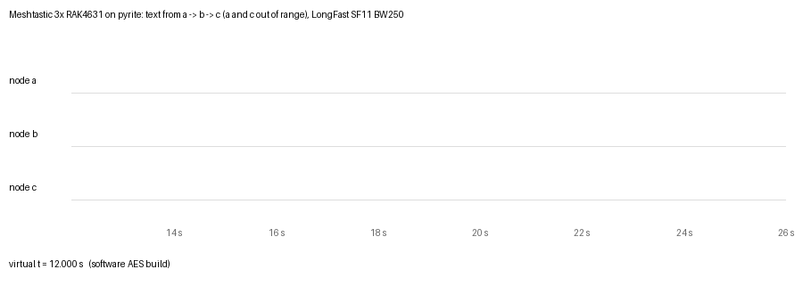
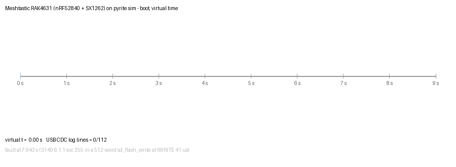

# Meshtastic on pyrite (nRF52840, RAK4631): learning pass

## Demo: three Meshtastic RAK4631 nodes, text a -> b -> c

### On the pyrite lora medium (pyrite#4211, PR #4212 build), 2026-11-22
`sim/three.yaml` now has two `type: lora` media (a-b, b-c) instead of `quantum: 0.00001` + `MESH_LINKS`; the peer sends with
`ctx.lora.send` and receives `on_lora` at the end of the sync word. Effective quantum 912 us (was 10 us). Same build, same commands
(minus `MESH_LINKS`). Machine load 4-11 (1-min) during the runs.

| run | quantum | wall (s) | guest insns a / b / c | cpu s per node | c `msg=Hello from A` |
| --- | --- | --- | --- | --- | --- |
| before, sim 0.10.6 | 10 us | 77.2 | 2.515 G / 2.554 G / 2.554 G | 38.8-41.0 | 22.323256 s |
| after, `PYRITE_PARALLEL=0` (x2) | 912 us | 60.0 / 59.8 | 2.48 G / 2.554 G / 2.554 G | 18.0-19.8 | 23.536943 s both |
| after, threaded (x2) | 912 us | 41.6 / 41.8 | 2.45 G / 2.554 G / 2.554 G | 21.3-25.5 | 24.851372 s both |

c decodes the text through b in every run. Times repeat within a run mode but not across modes or for a: the text is typed by
`send_text.py` over `--usb-raw`, a wall-clock host (the run is paced real-time, "fell behind" in stderr), so when it lands in virtual time
depends on host speed. The MeshCore sim (CLI-typed advert, no wall-clock host) gives identical TX times and instruction counts in both modes.
The table below and the GIF are the earlier 10 us run.

Run of 2026-11-22, sim 0.10.6, no BLE, region US, default LongFast (SF11 BW250 CR4/5), links a-b and b-c only, software AES (workaround below), 40 s virtual:
- a TX start 12.559 s, 34 B, 518 ms on air (ends 13.077 s). b TX start 21.225 s, 34 B (HopLim 3 -> 2, ends 21.744 s).
- c: `Received text msg from=0x666b7d60, id=0x5a5a0001, msg=Hello from A` at 22.323 s (c has no link to a: it can only have come through b).
- 2.51 G / 2.55 G / 2.55 G guest insns (a/b/c), ~56-58 MIPS per node, ~38 s cpu per node. Not `--record`ed (see below). GIF numbers are the TX lines and the c log line of this run.

Workaround, pyrite#4201: the default build fails to decrypt on every node (`Invalid protobufs ... (bad psk?)`, packets still relay opaquely, text and
NodeInfo alike). Rebuilding with `-DSIM_SOFT_AES=1` (sim-only flag in `src/platform/nrf52/NRF52CryptoEngine.cpp`: AES-CTR uses the base-class software path instead of
CryptoCell-310 `nRFCrypto_AES`) is the only change and c then decodes the text. So the CC310 AES-CTR path differs from software in the sim; whether that is the CC310
model or the way the library drives it is not yet separated (no register/DMA trace compared with the CC310 docs yet; filed as pyrite#4201, related #4054).

### Reproduce (from the repo root)
    NODES="a b c" EXTRA="-DMESHTASTIC_EXCLUDE_BLUETOOTH=1 -DSIM_SOFT_AES=1 -DUSERPREFS_CONFIG_LORA_REGION=meshtastic_Config_LoRaConfig_RegionCode_US" sim/build.sh
    (uv run --with meshtastic python3 -I sim/send_text.py 7101 /tmp/a.log &)
    MESH_AIR_LOG=1 sim run --scenario sim/three.yaml --usb-raw a.usbd:7101 --usb-cdc-console b.usbd --usb-cdc-console c.usbd --ascii --timeout 40 > run.out 2> air.log
    # strip ANSI from run.out, then:
    uv run --with pillow sim/make_relay_gif.py air.log sim/relay.gif run.out
Build writes sim/merged_{a,b,c}.hex (MBR + S140 + app, Nordic blob: not committed).

### How each piece was done
- Region/channel: build-time `USERPREFS_CONFIG_LORA_REGION=US`; the channel is the stock default (LongFast, PSK AQ==). No firmware logic patched.
- Node ids: pyrite gives every instance the same FICR DEVICEADDR (all nodes read 0xffffff4f) and a scenario cannot set it. The only firmware edit is a
  `SIM_MAC_LSB` override in `getMacAddr()` (src/platform/nrf52/main-nrf52.cpp), one build per node (ids ffffff01/02/03 before key generation; after the first
  boot the id becomes the CRC32 of the generated public key, so a, b, c end up with distinct random ids). Stand-in for factory identity, not logic.
- Send: Meshtastic serial API over USB CDC. `--usb-cdc-console NAME=text` cannot carry the frame (UTF-8 argv string: no 0x94 byte, no NUL), and
  `--usb-cdc-pty`/`--uart-pty` are single-machine only. `sim/send_text.py` is the USB host over `--usb-raw` (enumerate, DTR, want_config, one
  ToRadio TEXT_MESSAGE_APP broadcast). CDC bulk OUT is endpoint 1 (IN 0x82). After the API starts, a's debug log stops (expected).
- Receive: b and c debug logs on `--usb-cdc-console`; air events from the peer's `MESH_AIR_LOG`.
- SX1262 peer: copied from the MeshCore sim (`meshcore-sim-d0e0/sim/sx/sx1262.py`: shared air, `MESH_LINKS`, per-node noise registers, `MESH_AIR_LOG`), plus CAD:
  Meshtastic does listen-before-talk with SetCad, which the peer did not model, so no node ever transmitted. `SetCad` now raises CadDone (+CadDetected if
  a frame with the same SF/BW/freq is in flight) after (CadSymbolNum+1) symbols. MODELED SIMPLIFICATION, unmeasured.

### Why no --record
`--record` is refused with `--usb-raw`, and the text cannot be typed any other way (see Send). A deterministic recorded run needs either a pyrite flag to
type raw bytes at a CDC console, or a send path that needs no host. Open.

### USB CDC stall at 4.82 s (no-BLE build, single machine)
Not reproduced in the 3-node scenario (quantum 10 us): the USB log runs to 50 s on all nodes, and the enumeration/DTR/OUT/IN path works through `--usb-raw`.
So the earlier single-machine stall was not examined further and is not called a model bug; the TinyUSB trace in the section below still stands as the
evidence for the single-machine form. No pyrite issue filed.

### Workarounds and corrections
- BLE (pyrite#4252, 2026-11-23): the stock Bluetooth build now boots, advertises and relays (c decodes `Hello from A` at 25.25 s,
  default AES). Two causes. (1) The S140 assert at 7.94 s (10.24 s with region US) was the 41 us datasheet-max tWRITE: S140 writes the
  512-word half page inside one TIMER0 timeslot of 696 RTC ticks (21.24 ms, start RTC 0xb99, end 0xe51, check at 0x14a8c, assert
  `svc 255` at 0x14aa6); at 41 us the write ends at RTC 0xe54, 3 ticks late. Silicon 40.27 us (pyrite PR #4197, sim >= 0.10.8)
  fits; a board override back to 41000 faults again at the same PC. (2) This board file named the SX1262 peer `radio`, which
  replaced the chip's nRF RADIO entry of the same name, so PPI TIMER0 COMPARE0 -> RADIO TXEN landed on nothing and S140 never
  advertised. The peer is now `sx1262` (rak.board, three.yaml).
- Open: CC310 AES-CTR (pyrite#4201) so the demo can drop SIM_SOFT_AES; `--record`; per-node FICR identity in pyrite scenarios; text decoded at c.

---
(Earlier learning-pass notes follow; its tWRITE verdict is superseded by the correction above.)

Variant `rak4631` (nRF52840 + SX1262 on SPIM3), firmware 2.8.3.f584291, sim 0.10.6, model `NRF52840QIAA` (reported "incomplete").
Not for upstream.

## Run
`sim/build.sh`, then
`sim NRF52840QIAA run --board sim/rak.board --elf sim/bl0.hex --elf sim/fw.elf --timeout 12 --usb-cdc-console usbd --ascii --on-fault stop`

The Adafruit-core app expects Nordic's MBR + S140 6.1.1 SoftDevice below 0x26000. `bl0.hex` is that blob taken from the
PlatformIO Adafruit package (bootloader hex, UICR records stripped). The real SoftDevice runs in pyrite: MBR -> SD -> app, SVCall
forwarding, Bluefruit/LittleFS flash ops all work. Logs come over USB CDC (`usbd`), not a UART.

## Results (virtual time unless noted)

Rerun 2026-11-22 (rebuilt, sim 0.10.6, `--record`; `sim/make_gif.py <rec_dir>` makes the GIF from the bundle): rung 1 and 2 hold.
- Rung 1, boots (rerun: fault at 7.943 s, 64 Minst/s, 15.6 ns/insn): banner, I2C scan, NodeDB, LittleFS init, GPS/PowerFSM, no fault up to ~7.9 s. ~64 Minst/s guest (15.6 ns/insn).
- Rung 2, radio (rerun: `SX126x init result 0` at 4.155 s, `SX1262 init success` at 4.166 s): `SX126x init result 0`, `SX1262 init success` at 4.16 s. 10 s run: 264 M guest insns, 3.8 s wall.
- Needed two edits to the sim-fixtures SX1262 peer (`sim/sx/sx1262.py`, copy):
  1. RadioLib wakes the chip with a 1-byte NOP (0x00); the peer flagged it as a command error and the sticky error made every
     SetStandby fail the status check. NOP is now ignored.
  2. RadioLib's SX1262 class looks for version string `SX1261` (RADIOLIB_SX1262_CHIP_TYPE); peer returned `SX1262 V2B`.
     Peer string is datasheet-derived, unmeasured on silicon.
- Fault at 7.94 s with BLE: after "Init the Bluefruit", S140 executes `svc 255` (SD assert, escalates to HardFault inside TIMER0 IRQ8).
  The SD is inside a 512-word `sd_flash_write` (Adafruit `fal_program` half page) polling NVMC READY, 512 x 41 us = 21 ms.
  Cause, from a tWRITE sweep (board-file override `nvmc: program_word_ns: <v>`, same ELF, 12 s): 5, 10, 20, 30, 35 us run
  clean (BLE init at 6.9-7.7 s); 41 us (the default) faults at 7.943 s. The SD's limit is therefore between 17.9 and 21.0 ms for that write.
  nRF52840 PS v1.11 §4.3.10.1 gives tWRITE only as a 41 us max (no typ); pyrite charges the max for every word. Adafruit already writes
  half pages because S140 6.1.1 asserts on whole-page writes on silicon (devzone 40088), so silicon words are faster than the max.
  Earlier verdict (SUPERSEDED, see Workarounds and corrections): pessimistic model constant. Not measured on silicon (needs a DWT cycle count around a 512-word write).
  Evidence commented on pyrite#363. Same fault with the one-machine `quantum: 0.00001` scenario form (`sim/one.yaml`, needs a merged hex), so not pyrite#4051.
- With `-DMESHTASTIC_EXCLUDE_BLUETOOTH=1` (`EXTRA=... sim/build.sh`): no fault; the USB log stops after 4.82 s (last line cut mid-line at 4.8196 s).
  Rerun, 8 s with `--trace-symbol` on TinyUSB: the last CDC IN transfer (EP 0x82, 28 bytes) is armed at 4.819559 s and its completion event
  reaches `dcd_event_handler` at 4.819577 s; USBD IRQ (IRQ39) never fires again, `usbd_edpt_xfer` is never called again, `tud_task_ext` waits
  forever. Meanwhile `tud_cdc_n_write_flush` is called 32321 times in the next 1.2 s and 171 k SVCall/PendSV pairs follow by 8 s: the firmware
  spins writing the log into a CDC FIFO that nothing drains. Cause of the missing re-arm after that transfer is open (TinyUSB device side vs
  pyrite USB host side not yet separated); the BLE build keeps logging to 7.9 s, so the path differs with the SD absent. Region is UNSET, so the radio idles.
- Node id reads 0xffffff4f (FICR DEVICEADDR is the same on every instance), see pyrite skill known gaps.

## Not reached
Rung 3: the SX1262 peer has no shared air (RX only from a fixed schedule, TX only logged), and the serial API needs the USB log/CDC
path examined first.
